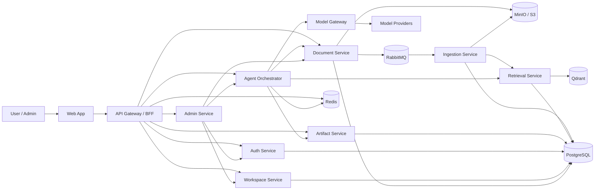
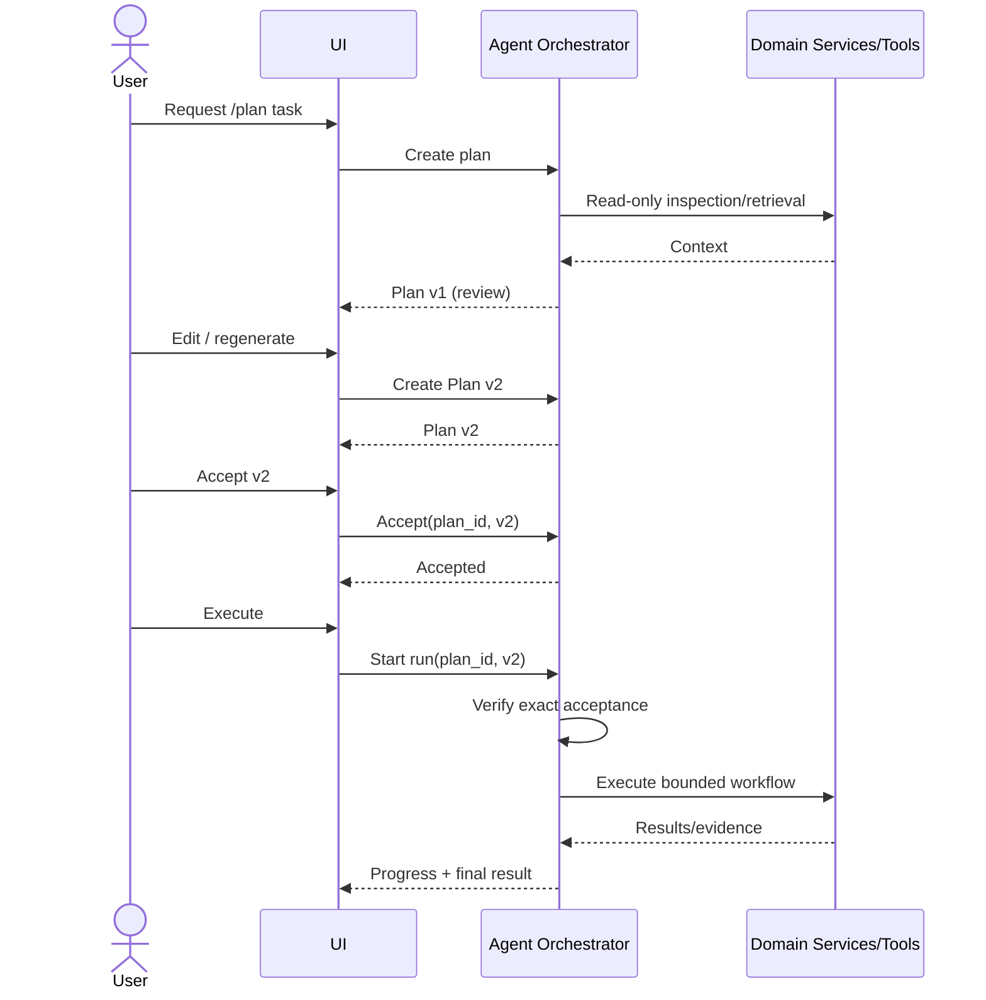

# Architecture Overview

## Main document flow

Development can use the optional `compose.ollama.yaml` overlay. Ollama serves only
the configured embedding model on the private Compose network, with an existing
read-only model cache. Domain services continue calling Model Gateway; the chat
provider remains independently configured. Embedding fingerprints isolate model
versions and Ingestion owns re-indexing and publishing replacement generations.

1. Authenticated user requests an upload URL or uploads through the gateway/document service.
2. Document service stores the raw file in object storage and records metadata.
3. An ingestion job is queued.
4. Ingestion parses the source, preserves page/structure metadata, chunks it, creates embeddings, and indexes retrievable content.
5. Retrieval service exposes authorized search over indexed sources.
6. Agent orchestrator uses retrieval and capability tools to answer or build artifacts.
7. Citations retain `document_id` plus page/chunk/anchor information so the frontend can focus the side panel.

## Plan-to-execution flow

