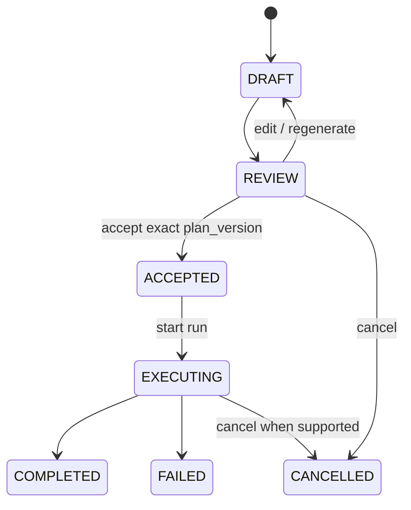

# Product Interaction Modes

Do not confuse these product modes with Codex's own UI modes. These are requirements for the Super Agentic RAG application.

## Two independent axes

### Interaction axis
- `ASK` — answer now.
- `PLAN` — prepare a proposed workflow; require human acceptance before execution.
- `AGENT` — execute an allowed bounded workflow and expose progress.

### Capability axis
- `LEARN`
- `RESEARCH`
- `WRITE`

Example: `PLAN + RESEARCH` prepares a literature-review plan; after acceptance, the run executes research steps. `ASK + LEARN` explains a selected concept immediately.

## Plan state machine



## Minimum plan model

```text
Plan
- plan_id
- user_id
- workspace_id
- capability
- status
- current_version
- created_at
- updated_at

PlanVersion
- plan_id
- version
- objective
- steps[]
- expected_outputs[]
- source_scope[]
- tool_scope[]
- constraints[]
- created_at

PlanAcceptance
- plan_id
- plan_version
- accepted_by_user_id
- accepted_at
- idempotency_key

AgentRun
- run_id
- plan_id?              # nullable for direct Agent mode
- accepted_plan_version?
- status
- started_at
- finished_at
- cancellation_reason?
```

## Enforcement rules

- `POST /plans/{plan_id}/accept` accepts only the latest reviewable version unless the API explicitly supports selecting a version.
- `POST /agent-runs` with a `plan_id` must verify a matching acceptance record for the requested current version.
- If version changes after acceptance, the old acceptance remains in audit history but cannot authorize the new version.
- Acceptance endpoint is idempotent for the same user/version/idempotency key.
- Authorization checks happen on every plan/read/accept/run route.

## What Plan mode may do before acceptance
Allowed: read workspace metadata, inspect selected sources, retrieve evidence, estimate steps, identify candidate tools, validate availability.

Not allowed: create/delete user artifacts as the task outcome, mutate external systems, send/export/publish content, launch long autonomous research loops, or perform other consequential planned actions.

A small internal read necessary to formulate the plan is not considered executing the plan.

## User-visible plan content
Show concise action summaries such as:

1. Search the selected papers for evaluation methodology.
2. Extract dataset, metric, and reported result into an evidence table.
3. Compare disagreements and limitations across papers.
4. Produce a cited synthesis and a reusable study artifact.

Do not expose private chain-of-thought, hidden reasoning tokens, or internal policy text.
