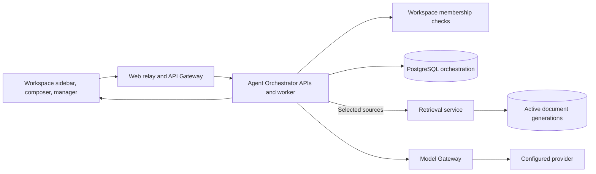

# Thiết kế và kiến trúc

## Quyết định thiết kế

Ask trước đây trả lời từ tài liệu và lịch sử hỏi đáp, còn Plan cũ là bản chạy workflow có bước approve/run. Gắn kế hoạch học vào workflow hay một chat khiến việc tiếp tục học ở chat khác, quản lý mục tiêu và lưu tiến độ khó phân biệt với trạng thái chạy job. Thiết kế mới giữ Ask, retrieval, PDF anchors và Agent hiện hữu, đồng thời chuyển Learning Plan thành thực thể riêng tư theo owner và workspace. Một Plan có thể được tham chiếu từ nhiều conversation, được chỉnh trong Workspace và giữ danh tính mục tiêu qua các lần sửa. Đổi lại cần lưu phiên bản, revision, kiểm tra quyền lúc đọc và lúc ghi, và xử lý việc một chat đang giữ tham chiếu cũ.

Sources quyết định tài liệu được retrieval và citation; Plan quyết định blueprint, tiến độ và hội thoại học nào có thể vào context. Ghép chúng thành một bộ chọn sẽ làm mất khả năng hỏi chỉ từ tài liệu, chỉ từ kế hoạch, từ cả hai hoặc hỏi chung. Chọn theo từng chat tránh ảnh hưởng cuộc hội thoại khác. No Plan mặc định cho chat mới. Nhật ký sự kiện riêng theo owner/workspace vẫn có thể cung cấp lịch sử học gần đây với dữ liệu giới hạn.

Create hợp lệ lưu Plan mới ngay, thay cho bước approve/run của workflow cũ. Edit hiện hữu có rủi ro ghi đè mục tiêu và tiến độ nên cần proposal bất biến cùng Change Preview rồi Accept. Completion là đề xuất cho đúng một objective đang pending, sinh cùng câu trả lời. Không thêm lượt model xác minh hay tự tick, để người học quyết định và giới hạn chi phí. Manual CRUD dùng cùng hợp đồng blueprint mà không cần AI. Progress ở cấp objective; activities chỉ là nội dung gợi ý. Thiết kế giữ legacy data để đọc trong History nhưng chặn đường tạo/chạy legacy PLAN đang hoạt động.

## Luồng dữ liệu

Frontend chuyển Learning Plan Selector vào sidebar, độc lập Sources, hỗ trợ No Plan và danh sách rút gọn. Manager phân cấp Day → Objective → Suggested Activities với detail và editor riêng. Create card tải bản Plan hiện tại bằng GET có kiểm tra quyền, hiển thị preview cuộn; lịch sử giữ reply và reference. History lưu conversation ID theo tab/account/workspace rồi đọc lại từ API. Structured Ask giữ claims/citations và unsupported parts; UI hiển thị phần thiếu bằng chứng trong reply sau phần có hỗ trợ. Copy giữ thứ tự đó; Save as artifact chỉ lấy phần document-supported.

API dưới `/v1/workspaces/{workspace_id}`: `GET/POST /learning-plans`, `GET/PUT/DELETE /learning-plans/{id}`, `GET/PUT /learning-cards/{id}`, `POST /conversations`, `GET/PUT /conversations/{id}/learning-plan`. Ask, Create/Edit và Retry tái sử dụng `/runs`, polling/SSE và worker. Membership qua Workspace service, dữ liệu riêng kiểm theo owner/workspace. Revision, idempotency key, run lease và transaction khóa đường ghi cục bộ. Việc kiểm tra membership từ service khác và commit SQL có cửa sổ riêng cần tiếp tục xác minh.

Worker pin query, Sources, Plan, version, duration và context theo run. Optional Rewrite hỗ trợ retrieval; Answer vẫn nhận query gốc. Context đầy đủ bắt buộc của Plan/progress được giữ; optional evidence, event/history/version được đóng gói theo ngân sách. Evidence ưu tiên các kết quả đầu và độ phủ tài liệu/trang. Không nguồn thì không retrieval; empty retrieval và lỗi retrieval là trạng thái khác nhau. Model Gateway chuẩn hóa finish reason; task prompts/demonstrations tĩnh tách Rewrite/Create/Edit/Answer, Answer có biến thể theo việc chọn Plan. Validator kiểm structured output, UUID, provenance, evidence labels, day/duration, phiên bản gốc và giới hạn blueprint canonical UTF-8 9.216 byte. Có repair giới hạn ở đường được hỗ trợ; dữ liệu bắt buộc quá lớn thất bại có kiểu. Citation chỉ resolve từ evidence thực sự cấp cho lượt đó, dùng tiếp Chunk/Segment và PDF anchors của Ask hiện hữu.

Migration 007 thêm Plan, content snapshots và events; 008 thêm selection/revision vào conversation; 009 thêm cards. Content version tăng khi blueprint content đổi; progress-only tăng state revision và ghi event, không tăng content version. Lưu trữ dùng UUID objective ổn định, tombstone, events và receipts cho Retry. Card cố định base revision, proposal và mục tiêu; từ pending đi đến accepted/rejected/invalidated. Giao dịch Accept cập nhật Plan/card/event; thay đổi Plan làm proposal cũ mất hiệu lực.

## Bản đồ code

| Tầng | File |
| --- | --- |
| Sidebar, chat, manager, Create/Edit/Completion cards | [Workspace UI](../../apps/web/app/workspaces/%5BworkspaceId%5D/) |
| Relay và flag map/method routing | [Gateway](../../services/api-gateway/app/main.py), [Orchestrator routes](../../services/agent-orchestrator/app/main.py) |
| Queue, Retry, retrieval, publish | [worker.py](../../services/agent-orchestrator/app/worker.py), [history.py](../../services/agent-orchestrator/app/history.py), [types.py](../../services/agent-orchestrator/app/types.py) |
| Packing và model schemas | [learning_ai.py](../../services/agent-orchestrator/app/learning_ai.py), [prompt bank](../../services/agent-orchestrator/app/learning_prompt_bank.json), [Answer refinement](../../services/agent-orchestrator/app/learning_answer_refinement.json), [Model Gateway](../../services/model-gateway/app/main.py) |
| Validation, revisions, persistence | [learning_blueprint.py](../../services/agent-orchestrator/app/learning_blueprint.py), [learning_store.py](../../services/agent-orchestrator/app/learning_store.py), [migrations](../../services/agent-orchestrator/app/migrations/versions/) |
| Regression | [Phase 05](../../tests/phase05/), [Browser flows](../../tests/phase01/workspace.spec.ts), [Citations](../ask-pipeline/sentence-citations.md) |

Runtime flags, provider và recoverability xem [Vận hành](operations-demo.md). Các hạn chế về event recall, semantic targeting, capacity và ACL/recovery evidence nằm trong [Kiểm chứng](verification.md) và [Bàn giao](handoff.md).
