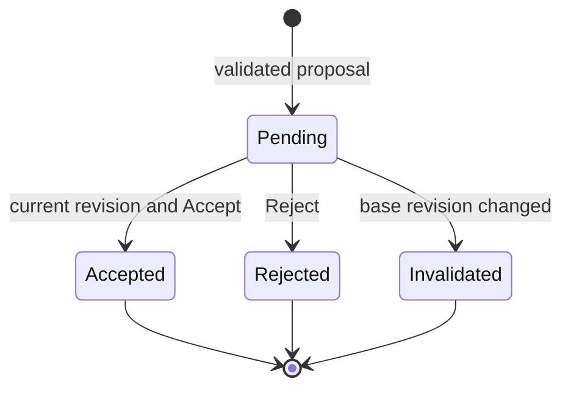

# Luồng chức năng

## Ask và hai bộ chọn

Ordinary Ask dùng câu hỏi trong composer ở chế độ Ask. Bảng mô tả context và kết quả mong đợi. Việc hoán đổi Plan chỉ cập nhật chat hiện tại qua selection revision; Sources giữ lựa chọn riêng.

| Sources | Plan | Context, output và trạng thái |
| --- | --- | --- |
| Không | No Plan | Hỏi chung hoặc dùng nhánh hội thoại tương thích; không retrieval, không document citation. Câu hỏi cần Plan hiện tại sẽ yêu cầu chọn Plan. |
| Có | No Plan | Retrieval giới hạn theo Sources đã cấp quyền; claims phải có evidence hợp lệ. Thiếu toàn bộ hoặc một phần được trình bày trong reply. |
| Không | Có | Dùng blueprint, mục tiêu và tiến độ; có thể hướng dẫn học hoặc đưa đề xuất khi đủ điều kiện. Plan provenance thay cho citation tài liệu. |
| Có | Có | Cùng dùng Plan và nguồn đã chọn. Tách provenance theo claim, citation trỏ đúng PDF/passage. Câu hỏi ngoài chủ đề Plan vẫn đi theo yêu cầu của người dùng. |

Hệ thống phân biệt không chọn tài liệu, không tìm thấy evidence trong tập được phép và lỗi truy cập/retrieval. Partner service failure hoặc output không hợp lệ có thể trả lỗi có kiểu. Ask bình thường lưu run/reply, không sửa Plan hay progress.

## Tạo, chỉnh và quản lý

| Workflow | Trigger và context | Validation, kết quả và side effects |
| --- | --- | --- |
| AI Create | Kích hoạt chip `/plan`, gửi mục tiêu. Auto để model đề xuất 1–7 ngày; Fixed gửi số ngày riêng. Có thể dùng Sources và context chat phù hợp. | Validate schema, số ngày và coverage, canonical size và objective identity trước khi lưu. Tạo Plan có pending objectives, snapshot và event; reply + reference/preview trong chat. Auto-select chỉ khi selection CAS còn khớp. |
| AI Edit | Chọn Plan, kích hoạt `/edit-plan`, gửi yêu cầu. Worker pin Plan/version/revision, context hợp lệ và Sources tùy chọn. | Model sinh draft; server so sánh theo objective ID để tạo Change Preview và lưu proposal với base revision. Draft lỗi, version mismatch hoặc không có proposal thì không đổi Plan. |
| Preview / Accept / Reject | Đọc thay đổi cấu trúc, bản đề xuất đầy đủ và review trước quyết định. | Accept kiểm lại scope, pending và revision rồi ghi Plan/card/event trong transaction; thao tác lặp không ghi thêm. Reject giữ Plan. Proposal stale không được áp dụng. |
| Manual CRUD | Workspace → Learning Plans. Tạo hoặc mở Edit; sửa ngày, objectives, activities hoặc tick/untick objective, Save/Cancel. Delete cần xác nhận. | Cùng blueprint guard và revision. Save ghi snapshot khi sửa nội dung và event phù hợp. Cancel không ghi. Xóa tombstone; tham chiếu mất hiệu lực, UI trở về lựa chọn an toàn khi đọc lại. |
| Plan-aware learning | Ordinary Ask khi đã chọn Plan. Ví dụ hỏi mục tiêu tiếp theo, Day 2, activities hoặc giải thích khái niệm. | Dùng trạng thái persisted khi bắt đầu run, ưu tiên mục tiêu chưa xong có liên quan; số liệu tài liệu vẫn theo evidence contract. Giảng bài hoặc acknowledgement không phải lý do để đổi progress. |

## Ba trigger Completion và một đường ghi

| Trigger | Input và hành vi dự kiến |
| --- | --- |
| Proactive | Người học tự trình bày hiểu biết đủ thuyết phục theo mục tiêu đang học. Câu trả lời có thể kèm đề xuất dù không có yêu cầu đánh dấu. |
| Explicit | Người học yêu cầu đóng một mục tiêu. Ưu tiên diễn đạt rõ ngày và tên mục tiêu; mục tiêu mơ hồ hoặc không hợp lệ cần làm rõ. |
| Requested Assessment | Người học yêu cầu đánh giá lời giải. Phản hồi phần đúng/sai, không gợi ý khi còn sai hoặc thiếu; nếu đủ thì có thể đề xuất mục tiêu tương ứng. |

Cùng lần sinh Answer trả readiness, claims và optional objective UUID. Server chỉ tạo card cho ID pending thuộc Plan đã pin, với reply hợp lệ và revision hiện hành khi publish. Card hiển thị tên mục tiêu cần xác nhận. Accept chỉ tick objective gắn vào proposal, cập nhật state revision/event. Reject giữ progress; stale hoặc completed không tạo thêm lần ghi. Reviewer cần phân biệt model chọn nhầm mục tiêu với mutation lệch khỏi thẻ đang hiển thị.

## Awareness, isolation và Retry

- **Events xuyên chat:** khi hỏi hoạt động học gần đây, event snapshot giới hạn theo owner/workspace có thể vào context, kể cả No Plan. Event summary giúp recall nhưng không bảo đảm đủ mọi sự kiện. No Plan không nạp full blueprint, version timeline hay câu trả lời tagged của Plan/khác Plan. Citation tài liệu vẫn thuộc Sources hiện tại.
- **Plan đã hoàn thành:** hỏi học tiếp khi không còn pending, hệ thống có thể giải thích trạng thái hoàn thành hoặc gợi ý bước học mới dưới dạng văn bản. Validator không có pending ID để phát Completion card; không tự tạo Plan hay mục tiêu.
- **Retry:** failed run giữ input gốc, gồm query, Sources, Plan/version, duration, history/event snapshot. Retry checks quyền và điều kiện hiện hành; Edit stale không dùng Plan mới rồi ghi đè. Create/Edit cùng Retry lineage có thể coalesce hoặc phục hồi receipt đã commit sau lỗi trả kết quả. Plan đã xóa không được hồi sinh. Selection conflict yêu cầu đọc trạng thái hiện tại, không ghi đè lựa chọn mới. Capacity, timeout, malformed output và lỗi dependency phải quan sát theo kiểu lỗi và state thực tế trước khi thử lại.

