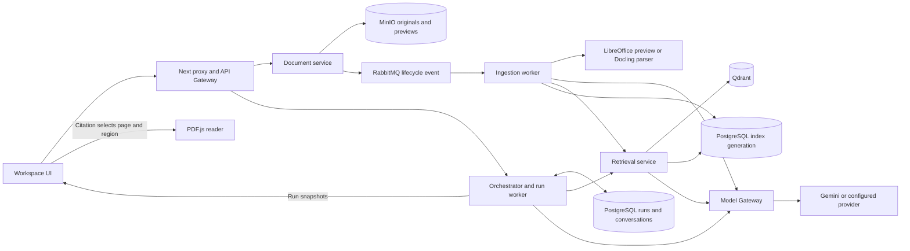

# AIpollo Ask architecture

This document describes the history-aware Ask and manual Retry implementation in the `feat/ask-history` worktree. The [Segment 05 audit](segment-05-audit-report.md) preserves the earlier baseline at `390356e956bd670aab1f45fcb3c6ac91a9536cd3`. See [debugging and verification](debugging.md) for live observations and test evidence.

## Upload to active index

1. Library submits bytes and filename through the same-origin Next `/v1` proxy and Gateway. Document checks workspace write access, validates the file, reserves metadata and stores the original in MinIO. When storage succeeds it marks the document ready and enqueues `document.uploaded.v1`. Native PDF preview is ready immediately. A DOCX upload creates both preview and index jobs. Ingestion fetches the original, calls isolated LibreOffice, then saves the generated PDF through Document. Preview readiness only confirms the reader has a PDF. See `apps/web/app/v1/[...path]/route.ts:11`, `services/api-gateway/app/main.py:182`, `services/document-service/app/main.py:169`, `:211`, `:271`, `services/ingestion-service/app/main.py:123`, `:171`.
2. The indexing loop waits for an embedding config. It leases a job and fetches the exact PDF used by the reader via `index-source`. Docling extracts text and Markdown tables, skips headers/footers and tracks title/section. Each parser chunk has `page` (one-based), `section`, `text`, and optional `region` (normalized top-left bounding coordinates). Adjacent compatible blocks are grouped, and the parser rejects failed, empty or over-limit extraction. See `services/ingestion-service/app/indexing.py:55`, `:97`, `:208`, `services/document-parser/app/main.py:35`, `:65`, `services/document-parser/app/chunking.py:38`.
3. Ingestion batches passage text for Model Gateway. Its embedding fingerprint derives from endpoint, model, dimensions and configured revision. On the Google Gemini host the gateway sends one input per upstream request, accepts a missing index only on the singleton path and validates any supplied index as integer zero. Other endpoints use indexed batches. Returned vectors must be nonzero and match configured dimensions. See `services/shared/rag_index.py:9`, `services/ingestion-service/app/indexing.py:126`, `:169`, `services/model-gateway/app/main.py:40`, `:102`.
4. Retrieval writes points to `rag_chunks_<fingerprint>` with dense and text vectors. Point IDs derive from generation and chunk ordinal. Payload includes workspace, document, generation and parser metadata. Ingestion derives a generation from document ID, index revision, fingerprint and source version, and publishes it to PostgreSQL under the job lease only after the writes succeed. Partial writes do not become active through that job. The active-index API returns succeeded jobs matching the requested fingerprint. See `services/retrieval-service/app/main.py:66`, `:98`, `services/ingestion-service/app/indexing.py:149`, `:169`, `services/ingestion-service/app/main.py:87`.

## Ask and citation navigation

1. The document shelf owns selected IDs. The composer intersects them with currently listed documents and requires a question and 1–100 sources. It posts an idempotent ASK run, with optional conversation ID. The gateway routes the authenticated request to Orchestrator, which checks workspace access and conversation ownership, creates a conversation if needed and stores the objective and queued run. The worker leases it in PostgreSQL and rechecks access at stage boundaries. See `apps/web/app/workspaces/[workspaceId]/document-shelf.tsx:67`, `apps/web/app/workspaces/[workspaceId]/interaction-panel.tsx:162`, `services/agent-orchestrator/app/main.py:230`, `:239`, `services/agent-orchestrator/app/worker.py:74`.
2. The worker loads eligible history before retrieval. When history fits the rewrite input and cost limits, it asks Model Gateway for one standalone search query. No history, budget rejection, a rewrite timeout or gateway failure, or unusable output falls back to the original question. The rewrite has a 12-second worker cap inside the run deadline. Only retrieval receives the rewritten query, with the original document IDs and limit 6. Retrieval keeps its workspace and actor checks, active generation filters, and hybrid ranking. If no selected document has an active index, retrieval returns empty before embedding. [Rewrite and worker flow](../../services/agent-orchestrator/app/worker.py#L165) · [Retrieval](../../services/retrieval-service/app/search.py#L76)
3. Answer generation receives the **original question**, bounded Q&A history, task and capability, and fresh passages packed as `id`, `text`, and `section`. The Ask input cap counts the system prompt, including examples, and user JSON in bytes. A plain Ask answer can recall eligible chat context with no packed passages. Structured tasks still need current evidence and keep their existing validation. If there are no usable claims, the result is insufficient evidence. [Compose and packing](../../services/agent-orchestrator/app/worker.py#L181)
4. A document claim has `source: "document"` and at least one evidence UUID. A derived claim can cite multiple current passages. The worker checks that every cited ID was packed for this run and hydrates each ID from retrieval metadata. This validates source membership, while semantic support and arithmetic remain model judgments. A plain Ask claim marked `source: "conversation"` requires `evidence: []` and displays **From this chat** without PDF pills. Earlier assistant answers provide context. User-supplied facts are the intended basis for conversation claims. Shared artifacts exclude conversation claims. Document pills still open the cited page and optional region in PDF.js. [Claim schema](../../services/agent-orchestrator/app/types.py#L85) · [Worker validation](../../services/agent-orchestrator/app/worker.py#L233) · [Citation UI](../../apps/web/app/workspaces/%5BworkspaceId%5D/interaction-panel.tsx#L355)

The [rewrite system prompt](../../services/agent-orchestrator/app/ask_prompts.py#L3) resolves follow-up references without answering the question. The [plain Ask answer prompt](../../services/agent-orchestrator/app/ask_prompts.py#L8) demonstrates separate claims sharing one passage, an inference that needs two passages, a mixed answer with a separate chat claim, and abstention when current evidence cannot support the question. Example IDs are illustrative.

## Conversation history and New chat

`orchestration.conversations` stores identity and ownership. `orchestration.runs` stores the objective, state and accepted result. Reopening a conversation loads run snapshots for display. The worker independently selects up to six earlier successful Ask runs scoped to the same workspace, user and conversation. It excludes the current run and rows at or after its creation time. It takes the newest eligible rows, using run ID to break ties, then supplies them in chronological order. Each turn carries the original user question and up to 900 characters of joined accepted answer text. Successful abstentions can contribute a question with an empty answer. The serialized history cap is the smaller of 4,500 bytes and one third of the configured input budget. Older citations and retrieved passages are excluded. **New chat** clears the current conversation and turn display, preserves the source selections, and creates a new conversation on the next Ask. [History query](../../services/agent-orchestrator/app/worker.py#L115) · [Conversation API](../../services/agent-orchestrator/app/main.py#L340)

## Manual Retry

When the final Ask completion returns HTTP 503 from Model Gateway, the worker stores an internal marker. Authorized run snapshots expose `retryable: true` and the saved Ask `objective`, while the public error stays `interaction_unavailable`. Rewrite failures can fall back and generic worker failures do not get the marker. Older failures lack it and cannot be classified retroactively. [Worker classification](../../services/agent-orchestrator/app/worker.py#L142) · [Run projection](../../services/agent-orchestrator/app/main.py#L27)

The **Retry** button beside the failed turn sends a fresh Ask through the normal runs endpoint with the saved question, source IDs, task, capability and conversation ID. A fresh idempotency key creates a separate run. A synchronous guard blocks repeated clicks and the button stays disabled while pending. Another eligible 503 shows the generic error and re-enables Retry. A successful result replaces the failed turn's display and includes its citations. The replacement mapping is in browser memory. After a full page reload, the original and retry are separate saved runs when both appear in history. An eligible saved failure can still be retried after reopening it. The gateway's automatic retry is separate. It makes one extra upstream attempt for HTTP 503 during final Ask compose, within the same run and request ID. [Web retry](../../apps/web/app/workspaces/%5BworkspaceId%5D/interaction-panel.tsx#L193) · [Gateway retry](../../services/model-gateway/app/main.py#L202)

## Key boundary fields

| Boundary | Request → response |
|---|---|
| Web → Document | `POST /v1/workspaces/{workspace_id}/documents`, bytes, `X-Filename`, idempotency key → document ID, media type, `preview_ready`. |
| Document → Ingestion | `document.uploaded.v1`, workspace/document/request IDs and media type → durable preview/index jobs. |
| Ingestion → Parser / Model Gateway | PDF bytes → chunks with page/section/text/region. `{texts,fingerprint}` → `{vectors}`; config gives fingerprint and dimensions. |
| Ingestion → Retrieval | `index-batch` with scope in path and `{config,generation,offset,chunks,vectors}` → 204. |
| Web → Orchestrator | `POST /v1/workspaces/{workspace_id}/runs` with `{mode:"ASK",objective:{query,document_ids,capability,task},conversation_id?}` and idempotency key → 202, run/conversation IDs and status. |
| Worker → Retrieval | Delegated workspace/user path, `{query,document_ids,limit}` → `{indexed_documents,evidence}`; each evidence adds document ID, chunk ID, name, score to parser metadata. |
| Worker → Model Gateway | `{messages,max_tokens,retry_on_unavailable?}` → `{text,input_tokens?,output_tokens?}`. Rewrite expects `{query}`. Plain Ask generation expects `{claims:[{text,source,evidence}]}`. |
| Worker → Web | Run snapshots expose status, step, generic error, retryability, the saved Ask objective, and a result with claims and hydrated citations. |

Schemas: `services/shared/rag_index.py:15`, `services/retrieval-service/app/search.py:20`, `services/agent-orchestrator/app/types.py:25`, `:75`, `:102`, `services/model-gateway/app/main.py:156`.
