# Toàn bộ Luồng chạy & Lưu đồ End-to-End Hệ thống Super Agentic RAG — Branch `dev-DuyAnh`

> **Phiên bản mã nguồn tham chiếu:** Branch `dev-DuyAnh` · Commit `694e481` (`feat(rag): adaptive sentence citations and opt-in agentic learning, research, and writing workflows`)  
> **Phạm vi:** Toàn bộ **21 luồng chạy End-to-End** (mỗi luồng gồm **Lưu đồ Mermaid End-to-End** + **Bảng Execution Grid chi tiết 7 cột**) xuyên suốt 10 FastAPI microservices, Next.js Web Client/Proxy, PostgreSQL, Redis, RabbitMQ, Qdrant và MinIO.  
> **Bản HTML tương tác:** Mở [system-flows-grid.html](system-flows-grid.html) trong trình duyệt để tương tác click node, mô phỏng chạy từng bước và lọc trực quan.

---

## Mục lục

1. [Bản đồ Kiến trúc & Ma trận Feature Flags](#1-bản-đồ-kiến-trúc--ma-trận-feature-flags)
2. [Nhóm 1: Identity, Tenancy & Admin Operations (Flow 01–03)](#2-nhóm-1-identity-tenancy--admin-operations-flow-0103)
3. [Nhóm 2: Document Lifecycle, Parsing & Vector Indexing (Flow 04–07)](#3-nhóm-2-document-lifecycle-parsing--vector-indexing-flow-0407)
4. [Nhóm 3: Retrieval, Ask & Adaptive Sentence Citations (Flow 08–10)](#4-nhóm-3-retrieval-ask--adaptive-sentence-citations-flow-0810)
5. [Nhóm 4: Agentic Workflows — PLAN, LEARN, RESEARCH, WRITE (Flow 11–16)](#5-nhóm-4-agentic-workflows--plan-learn-research-write-flow-1116)
6. [Nhóm 5: Artifacts, Adaptive Learning & Source Discovery (Flow 17–21)](#6-nhóm-5-artifacts-adaptive-learning--source-discovery-flow-1721)
7. [Tổng hợp Advisory Locks, Leases & Runtime Budgets](#7-tổng-hợp-advisory-locks-leases--runtime-budgets)

---

## 1. Bản đồ Kiến trúc & Ma trận Feature Flags

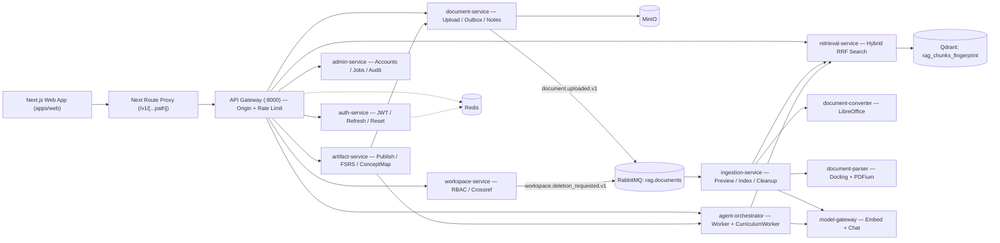

### Bảng điều khiển Feature Flags (`compose.dev.yaml` & `/workflow-features`)

| Feature Flag | Mặc định | Service sở hữu | Ảnh hưởng lên luồng chạy |
| :--- | :--- | :--- | :--- |
| `INDEX_SENTENCE_CITATIONS` | `false` | `document-parser` | Bật `Geometry(pdf)` căn chỉnh tọa độ từng câu (`citation_segments_v1`) khi parse PDF mới |
| `ASK_SENTENCE_CITATIONS` | `legacy` | `agent-orchestrator` | Chế độ mặc định nếu client bỏ qua `citation_mode` (`legacy` \| `auto` \| `single` \| `two`) |
| `AGENTIC_WORKFLOW_ENABLED` | `false` | `agent-orchestrator` | Cho phép truyền mảng 1–6 `steps` tùy biến vào `PLAN` (`409 feature_disabled` khi tắt) |
| `AGENTIC_CURRICULUM_ENABLED` | `false` | `agent-orchestrator` | Kết hợp với `AGENTIC_WORKFLOW_ENABLED`, kích hoạt `CurriculumWorker` cho `PLAN + LEARN + study_guide` (`curriculum_days` 1–6) |
| `AGENTIC_TUTOR_ENABLED` | `false` | `agent-orchestrator` | Bật `socratic_tutor` trong `ASK` (`guide`/`hint`/`solution`) |
| `AGENTIC_RESEARCH_ENABLED` | `false` | `agent-orchestrator` | Điều hướng `AGENT`/`PLAN` + `RESEARCH` (`comparison`, `evidence_table`, `synthesis`, 2–5 docs) qua LangGraph `ResearchGraph` |
| `AGENTIC_WRITING_ENABLED` | `false` | `agent-orchestrator` | Điều hướng `AGENT`/`PLAN` + `WRITE` + `draft` qua LangGraph `CitedDraft` |
| `AGENTIC_DEFENSE_ENABLED` | `false` | `agent-orchestrator` | Bật `mock_defense` trong `ASK` |
| `AGENTIC_DISCOVERY_ENABLED` | `false` | `agent-orchestrator` | Công bố cờ `discovery` cho UI hiển thị nút duyệt tìm Crossref khi thiếu bằng chứng |
| `ADAPTIVE_FLASHCARDS_ENABLED` | `false` | `artifact-service` | Bật API thẻ ôn tập FSRS (`/cards`, `/cards/{id}/reviews`) |
| `INTERACTIVE_CONCEPT_MAP_ENABLED` | `false` | `artifact-service` | Trả về đồ thị `concept_map` (`nodes`/`edges`) khi đọc artifact `mind_map` |

### Ma trận Định tuyến `Capability × Mode × Task` (`services/agent-orchestrator/app/types.py`)

| Capability | Task | `ASK` | `PLAN` | `AGENT` | Pipeline thực thi khi bật Flag |
| :--- | :--- | :---: | :---: | :---: | :--- |
| `LEARN` | `answer` | ✅ | ✅ | ✅ | `ASK`: History + Rewrite + Hybrid Search + Adaptive Sentence Citations (`segment`/`chunk`). `PLAN`/`AGENT`: Retrieve + Compose |
| `LEARN` | `explanation` | ✅ | ✅ | ✅ | Standard Retrieve + Compose (`OUTPUTS["explanation"]`) |
| `LEARN` | `study_guide` | ✅ | ✅ | ✅ | `PLAN` + `curriculum_days=1..6` -> `CurriculumWorker` bất đồng bộ (`plan_drafts`) |
| `LEARN` | `quiz` | ✅ | ✅ | ✅ | Retrieve + Compose (`FIELD_KEYS["quiz"]`: `question`, `options`, `answer`) |
| `LEARN` | `flashcards` | ✅ | ✅ | ✅ | Retrieve + Compose (`FIELD_KEYS["flashcards"]`: `front`, `back`), lưu sang FSRS `StudyDeck` |
| `LEARN` | `mind_map` | ✅ | ✅ | ✅ | Retrieve + Compose (`FIELD_KEYS["mind_map"]`: `parent`, `child`, `relationship`), dựng `ConceptMap` |
| `LEARN` | `socratic_tutor` | ✅ | ❌ `422` | ❌ `422` | `Worker.compose` chế độ `GeneratedTutorAnswer` (`guide`/`hint`/`solution`, max 1 câu hỏi `?`) |
| `RESEARCH` | `answer` | ✅ | ✅ | ✅ | Standard Retrieve + Compose |
| `RESEARCH` | `comparison` | ✅ | ✅ | ✅ | `AGENT`/`PLAN` + `AGENTIC_RESEARCH_ENABLED` + 2–5 docs -> LangGraph `ResearchGraph` |
| `RESEARCH` | `evidence_table` | ✅ | ✅ | ✅ | `AGENT`/`PLAN` + `AGENTIC_RESEARCH_ENABLED` + 2–5 docs -> LangGraph `ResearchGraph` |
| `RESEARCH` | `synthesis` | ✅ | ✅ | ✅ | `AGENT`/`PLAN` + `AGENTIC_RESEARCH_ENABLED` + 2–5 docs -> LangGraph `ResearchGraph` |
| `RESEARCH` | `screening` | ✅ | ✅ | ✅ | Standard Retrieve + Compose (`FIELD_KEYS["screening"]`: `source`, `decision`, `reason`) |
| `RESEARCH` | `extraction` | ✅ | ✅ | ✅ | Standard Retrieve + Compose (`FIELD_KEYS["extraction"]`: `source`, `field`, `value`) |
| `RESEARCH` | `mock_defense` | ✅ | ❌ `422` | ❌ `422` | `defense.py:defend` (Draft vs Counter-sources + `CounterCheck` kiểm chứng mâu thuẫn) |
| `WRITE` | `draft` | ✅ | ✅ | ✅ | `AGENT`/`PLAN` + `AGENTIC_WRITING_ENABLED` -> LangGraph `CitedDraft` (`verified_draft=true`) |
| `WRITE` | `answer`, `rewrite`, `summary`, `citation_review` | ✅ | ✅ | ✅ | Standard Retrieve + Compose theo template `OUTPUTS[task]` |

---

## 2. Nhóm 1: Identity, Tenancy & Admin Operations (Flow 01–03)

### Flow 01 — Authentication, JWT 5-min & Transparent Refresh Rotation

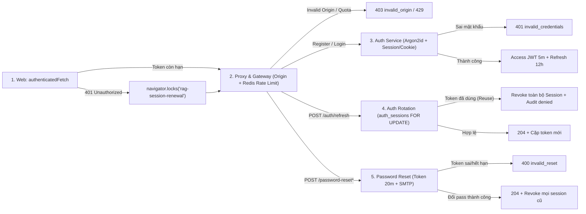

| Bước | Layer / Service | File & Symbol | Input / Auth / Guard | Persistence / External I/O | Output / Next State | Fallback / Error Guard |
| :--- | :--- | :--- | :--- | :--- | :--- | :--- |
| 1 | Web Client | `apps/web/app/lib/api.ts:authenticatedFetch`, `renewSession` | Cookie HttpOnly (`access`, `refresh`) | `fetch('/v1/...')`, dùng `navigator.locks('rag-session-renewal')` chống race nhiều tab | Nếu `401` trên `/v1/workspaces/*` hoặc `/v1/admin/*` -> tự gọi `POST /v1/auth/refresh` rồi replay request | Lỗi network/timeout 8s -> ném `RenewalUnconfirmed` (`401`) |
| 2 | Next Proxy & Gateway | `apps/web/app/v1/[...path]/route.ts:relay`, `api-gateway/app/main.py:proxy` | Check regex path, `Origin == WEB_ORIGIN` cho write, `MAX_BODY_BYTES = 16 KiB` | Redis rate limit `gateway:{path}:{sha256(ip)}` (`AUTH_PEER_LIMIT=100` / 900s) | Chuyển tiếp cookie `access` (và `refresh` chỉ cho `login`/`logout`/`refresh`) sang `auth-service` | Sai Origin -> `403 invalid_origin`; quá hạn mức -> `429` |
| 3 | Auth Service (Register/Login) | `auth-service/app/main.py:register`, `login` | Password >= 8 ký tự, có `[A-Z]`, `[0-9]`, ký tự đặc biệt; Redis `limit_account` | Argon2id (`Semaphore(4)` + `dummy_hash` chống timing attack); `INSERT identity.accounts`, `identity.auth_sessions`, `identity.refresh_tokens`, `identity.audit` | `204` (register) hoặc `Account` + set cookie JWT access (`<= 300s`) + refresh (`<= 43200s`) | Đăng nhập sai -> `401 invalid_credentials`; register email trùng vẫn trả `204` (chống enumeration) |
| 4 | Auth Service (Refresh Rotation) | `auth-service/app/main.py:refresh` | Cookie `refresh` | `SELECT ... FROM identity.auth_sessions FOR UPDATE`; kiểm tra `consumed_at` trên `identity.refresh_tokens` | Đánh dấu token cũ `consumed_at`, phát cặp token mới + cookie access mới (`204`) | Phát hiện **reuse** (`consumed_at IS NOT NULL`) -> **thu hồi toàn bộ session** (`revoked_at=now()`), ghi audit `session.refresh_reuse` |
| 5 | Auth Service (Password Reset) | `auth-service/app/main.py:request_reset`, `confirm_reset` | Email + token 43 ký tự (`^[A-Za-z0-9_-]{43}$`) | Lưu `sha256(token)` vào `identity.password_resets` (TTL 20 phút); gửi email SMTP background | Reset mật khẩu -> xóa reset row, thu hồi toàn bộ `auth_sessions` hiện hữu (`204`) | Link hết hạn/sai -> `400 invalid_reset`; chưa cấu hình SMTP vẫn trả `204` âm thầm |

---

### Flow 02 — Workspace RBAC, Sharing & Cascading Deletion

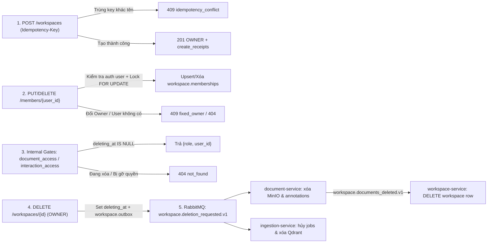

| Bước | Layer / Service | File & Symbol | Input / Auth / Guard | Persistence / External I/O | Output / Next State | Fallback / Error Guard |
| :--- | :--- | :--- | :--- | :--- | :--- | :--- |
| 1 | Workspace Service (Create) | `workspace-service/app/main.py:create_workspace` | `Actor` (`auth-service /internal/v1/session`), header `Idempotency-Key` | `INSERT workspace.create_receipts` + `workspace.workspaces` + `workspace.audit` | `201 Created` (`role="OWNER"`) | Trùng key khác tên -> `409 idempotency_conflict` |
| 2 | Workspace Service (RBAC & Share) | `workspace-service/app/main.py:set_member`, `remove_member`, `lock_workspace` | Chỉ `OWNER` được chia sẻ (`EDITOR` hoặc `VIEWER`); `FOR UPDATE` trên `workspaces` | Kiểm tra user tồn tại qua `GET /internal/v1/users/{id}`; upsert `workspace.memberships`; ghi `workspace.audit` | `Member` (`PUT`) hoặc `204` (`DELETE`) | Đổi role chính Owner -> `409 fixed_owner`; user không tồn tại -> `404` |
| 3 | Internal Access Gates | `workspace-service/app/main.py:document_access`, `interaction_access` | Service token (`X-Document-Service-Token` / `X-Interaction-Service-Token`) | Query `ACCESSIBLE` (`deleting_at IS NULL`) | Trả `{role, user_id}` để các service khác kiểm tra quyền | Workspace đang xóa hoặc user bị gỡ -> `404 not_found` |
| 4 | Cascading Delete (Phase 1) | `workspace-service/app/main.py:delete_workspace` | `OWNER` | Set `deleting_at = now()`, enqueue `workspace.deletion_requested.v1` vào `workspace.outbox` | `202 Accepted` (ẩn ngay khỏi mọi truy vấn `ACCESSIBLE`) | Gọi lặp lại trả idempotent `202` |
| 5 | Cross-Service Cleanup (Phase 2) | `document-service:start_workspace_cleanup`, `cleanup_one`, `ingestion-service:handle_event`, `cleanup_one` | RabbitMQ `rag.documents` | Document xóa MinIO objects & annotations; Ingestion hủy jobs & xóa points Qdrant; Document phát `workspace.documents_deleted.v1` -> Workspace `DELETE FROM workspace.workspaces` | Xóa sạch dữ liệu liên kết không để lại rác | Lỗi MinIO/Qdrant retry exponential backoff tối đa 8 lần |

---

### Flow 03 — Admin Console Operations

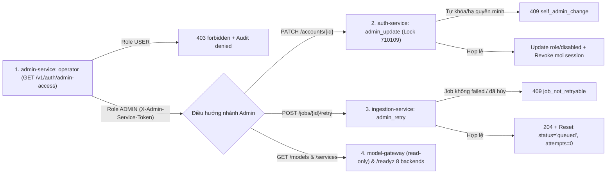

| Bước | Layer / Service | File & Symbol | Input / Auth / Guard | Persistence / External I/O | Output / Next State | Fallback / Error Guard |
| :--- | :--- | :--- | :--- | :--- | :--- | :--- |
| 1 | Admin Gateway & Guard | `admin-service/app/main.py:operator`, `relay` | Cookie `ACCESS_COOKIE` -> `GET auth-service/v1/auth/admin-access` | Gắn `X-Admin-Service-Token` chuyển tiếp tới service sở hữu | Cho phép thao tác nếu `role == 'ADMIN'` | Role `USER` -> `403 forbidden` + ghi audit `admin.access` denied |
| 2 | Accounts & Role Mutation | `auth-service/app/main.py:admin_accounts`, `admin_update` | `AccountUpdate(role, disabled)` | Advisory lock `710109`; cập nhật `identity.accounts`; **thu hồi toàn bộ `auth_sessions`** của target user; ghi audit `admin.account_updated` | Trả bản ghi account mới | Admin tự khóa/hạ quyền chính mình -> `409 self_admin_change` |
| 3 | Ingestion Jobs & Retry | `ingestion-service/app/main.py:admin_jobs`, `admin_retry` | `job_id` | Reset `status='queued', attempts=0, error_code=NULL` nếu chưa bị hủy workspace/document | `204 No Content`, `IndexWorker` tự động nhận lại job | Job không ở trạng thái `failed` hoặc doc đã hủy -> `409 job_not_retryable` |
| 4 | Readiness & Model Config Views | `admin-service/app/main.py:services`, `models`; `model-gateway/app/main.py:admin_models` | Admin token | Gọi song song `/readyz` trên 8 backend services; đọc metadata config (read-only) | Bảng trạng thái hệ thống, audit logs, models | Service timeout 2s -> `ready: false`; cấu hình model trên UI là read-only |

---

## 3. Nhóm 2: Document Lifecycle, Parsing & Vector Indexing (Flow 04–07)

### Flow 04 — Document Upload, Security Inspection & Transactional Outbox

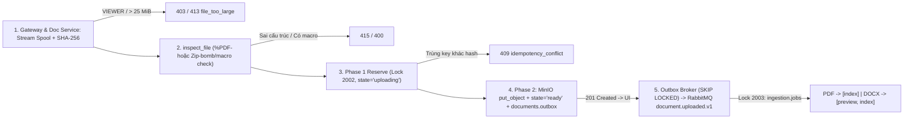

| Bước | Layer / Service | File & Symbol | Input / Auth / Guard | Persistence / External I/O | Output / Next State | Fallback / Error Guard |
| :--- | :--- | :--- | :--- | :--- | :--- | :--- |
| 1 | Upload Ingress | `api-gateway:proxy`, `document-service/app/main.py:upload` | `Content-Type: application/octet-stream`, `Idempotency-Key`, `X-Filename`, role `OWNER`/`EDITOR` | Stream ra `TemporaryFile`, tính size & `SHA-256` | Chuẩn bị kiểm tra định dạng | `VIEWER` -> `403`; file `> 25 MiB` -> `413 file_too_large` |
| 2 | Magic-byte & Zip-bomb Check | `document-service/app/storage.py:inspect_file` | Bytes tạm trên đĩa | PDF: kiểm tra `%PDF-` ở byte 0. DOCX: unpack Zip kiểm tra `<= 2000` entries, uncompressed `<= 128 MiB`, không encryption, không `..`, không `vbaproject.bin` | Xác định `media_type` (`PDF` hoặc `DOCX`) | Sai cấu trúc/chứa macro -> `415` / `400` |
| 3 | Phase 1 Reservation | `document-service/app/main.py:upload` | `require_open` (`pg_advisory_xact_lock(..., 2002)`) | `INSERT INTO documents.items(..., state='uploading') ON CONFLICT (workspace_id, actor_id, idempotency_key) DO NOTHING` | Giữ chỗ `document_id` | Trùng key nhưng khác hash/filename -> `409 idempotency_conflict`; trùng key đang `ready` -> trả lại doc cũ |
| 4 | Phase 2 MinIO & Outbox | `document-service/app/main.py:upload`, `rag_events.py:enqueue` | File stream | `MinIO.put_object('{ws}/{doc_id}/original')`; cùng 1 DB transaction cập nhật `state='ready'`, `preview_ready=(is_pdf)` và insert `documents.outbox` (`document.uploaded.v1`) | `201 Created` trả về cho UI | Lỗi MinIO -> trả `503`, job `cleanup_one` dọn rác uploading quá 1 giờ |
| 5 | Outbox Broker & Job Spawn | `rag_events.py:publish_one`, `ingestion-service/app/main.py:handle_event` | `FOR UPDATE SKIP LOCKED` trên `documents.outbox` | Publish persistent vào RabbitMQ `rag.documents` (`mandatory=True`); `ingestion` nhận sự kiện dưới Advisory Lock `2003` | Tạo `ingestion.jobs`: PDF -> `['index']`; DOCX -> `['preview', 'index']` | Nếu doc/workspace đã hủy -> tạo job ở trạng thái `cancelled` |

---

### Flow 05 — DOCX Preview Conversion

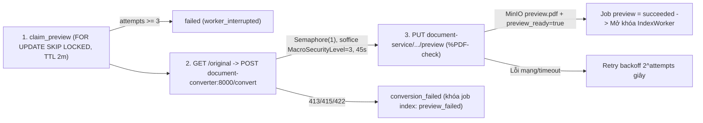

| Bước | Layer / Service | File & Symbol | Input / Auth / Guard | Persistence / External I/O | Output / Next State | Fallback / Error Guard |
| :--- | :--- | :--- | :--- | :--- | :--- | :--- |
| 1 | Claim Preview Job | `ingestion-service/app/main.py:claim_preview` | `kind='preview'`, `attempts < 3` | Lock `FOR UPDATE SKIP LOCKED`, cấp `lease_id` TTL **2 phút** | `status='running'` | Timeout quá 3 lần -> `failed` (`worker_interrupted`) |
| 2 | Fetch & Convert DOCX | `ingestion-service/app/main.py:convert`, `document-converter/app/main.py:convert` | Internal token | `GET document-service/.../original` -> `POST document-converter:8000/convert` (`asyncio.Semaphore(1)`, LibreOffice headless với `MacroSecurityLevel=3`, timeout 45s) | Nhận bytes `upload.pdf` | Timeout / lỗi LibreOffice -> `conversion_failed` (khiến job `index` chờ cũng chuyển `preview_failed`) |
| 3 | Save Preview | `document-service/app/main.py:save_preview` | Bytes PDF | Kiểm tra lại `%PDF-`, lưu MinIO `{ws}/{doc_id}/preview.pdf`, set `preview_ready=true` | Job `preview` -> `succeeded`, mở khóa cho `IndexWorker` | Retry backoff `2^attempts` giây nếu lỗi mạng |

---

### Flow 06 — Docling Parsing & Sentence Geometry Extraction (`INDEX_SENTENCE_CITATIONS`)

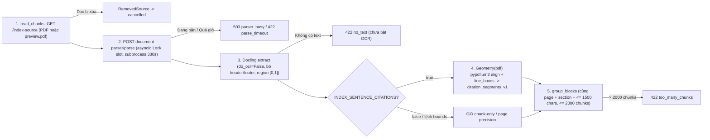

| Bước | Layer / Service | File & Symbol | Input / Auth / Guard | Persistence / External I/O | Output / Next State | Fallback / Error Guard |
| :--- | :--- | :--- | :--- | :--- | :--- | :--- |
| 1 | Fetch Index Source | `ingestion-service/app/indexing.py:read_chunks`, `document-service/app/main.py:index_source` | `preview_ready=true` | `GET .../index-source` (PDF gốc hoặc `preview.pdf` của DOCX) | PDF bytes (`<= 25 MiB`) | Doc bị xóa -> `RemovedSource` (`cancelled`) |
| 2 | Isolated Subprocess Parse | `document-parser/app/main.py:parse`, `converted` | `asyncio.Lock` (`slot`), `Content-Type: application/pdf` | Spawn subprocess `python -m app.conversion` với wall timeout `parse_wall` (`300 + 30s`) | Đọc file JSON output | Đang bận -> `503 parser_busy` + `Retry-After`; quá hạn -> `422 parse_timeout` |
| 3 | Docling Extraction | `document-parser/app/conversion.py:parse_pdf`, `blocks` | `do_ocr=False`, `max_num_pages=300` | Loại `PAGE_HEADER`/`PAGE_FOOTER`, chuyển bảng sang Markdown, cập nhật `section`, chuẩn hóa `region` về `[0, 1]` | Stream `IndexedChunk` | Không có text -> `422 no_text` (cần OCR ngoài phạm vi) |
| 4 | Sentence Geometry Alignment | `document-parser/app/segment_geometry.py:Geometry`, `fragment_segments` | Bật khi `INDEX_SENTENCE_CITATIONS == "true"` | `pypdfium2` đọc từng ký tự + `get_charbox` trên trang không xoay/crop; `Geometry.align` khớp duy nhất với văn bản (cho phép fold ngoặc kép); `line_boxes` gộp box theo dòng (`<= 8` dòng/câu) | Gắn `citation_segments_v1` với `precision`: `line` / `coarse` / `page` | Không khớp duy nhất hoặc lệch bounds -> fallback về chunk-only hoặc `page` |
| 5 | Canonical Chunking | `document-parser/app/chunking.py:group_blocks`, `join_blocks` | `CHUNK_SIZE = 1500`, `MAX_CHUNKS = 2000` | Gom block thỏa 3 bất biến: **cùng `page`**, **cùng `section`**, **tổng độ dài `<= 1500`**; dịch chuyển offset `start`/`end` của từng sentence segment | Trả danh sách `IndexedChunk` hợp lệ | Quá 2000 chunks -> `422 too_many_chunks` |

---

### Flow 07 — Embedding Batching, Qdrant Upsert & Atomic Index Publication

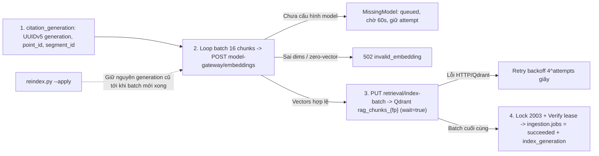

| Bước | Layer / Service | File & Symbol | Input / Auth / Guard | Persistence / External I/O | Output / Next State | Fallback / Error Guard |
| :--- | :--- | :--- | :--- | :--- | :--- | :--- |
| 1 | Deterministic Generation ID | `ingestion-service/app/indexing.py:citation_generation` | `chunks`, `config.fingerprint` | `revision = "docling-2.150.1-page-v1"` (+ `":sentences-v1"` nếu có segments); `generation = uuid5(doc_id, "{rev}:{fp}:{sha256}")`; `point_id = uuid5(gen, ordinal)`; `segment_id = uuid5(point, "sentence:v1:{ord}")` | Mọi chunk & segment có UUID tất định | Đổi model/endpoint/dimensions sẽ tạo fingerprint mới hoàn toàn tách biệt |
| 2 | Batch Embedding Dispatch | `indexing.py:embed`, `model-gateway/app/main.py:embed_batch`, `fetch_embeddings` | Batch 16 chunks (`f"{section}\n{text}"[:1800]`), timeout `60s` | **Ollama:** `POST /api/embed` (`num_ctx=8192, num_thread=4, truncate=false`). **Gemini:** 4 concurrent singletons (`Semaphore(4)`). **OpenAI:** batch `/embeddings` sort theo `index` | `vectors` khớp `dimensions` và khác zero-vector | Sai kích thước/zero vector -> `502 invalid_embedding`; model chưa cấu hình -> `MissingModel` (chờ 60s, hoàn trả attempt) |
| 3 | Qdrant Upsert | `indexing.py:publish`, `retrieval-service/app/main.py:prepare`, `index_batch` | `ordering="strong"`, `wait="true"` | Tạo collection `rag_chunks_{fingerprint}` (Cosine, `on_disk=true`, payload index `workspace_id`, `document_id`, `generation`, `text` BM25 word tokenizer) | Ghi points vào Qdrant | Lỗi kết nối -> backoff `4^attempts` giây |
| 4 | Atomic Publication & Reindex | `indexing.py:publish`, `reindex.py:reindex` | Advisory Lock `2003`, kiểm tra `lease_id` còn hạn | Batch cuối cập nhật `ingestion.jobs`: `status='succeeded', index_generation=:gen, embedding_fingerprint=:fp` | Tài liệu chính thức xuất hiện trong Search & Ask | Chạy `reindex.py --apply` chỉ requeue job, **giữ nguyên generation cũ** cho đến khi generation mới publish xong |

---

## 4. Nhóm 3: Retrieval, Ask & Adaptive Sentence Citations (Flow 08–10)

### Flow 08 — Public & Delegated Hybrid Retrieval Engine

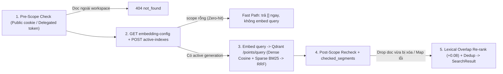

| Bước | Layer / Service | File & Symbol | Input / Auth / Guard | Persistence / External I/O | Output / Next State | Fallback / Error Guard |
| :--- | :--- | :--- | :--- | :--- | :--- | :--- |
| 1 | Auth & Double-Scope Pre-check | `retrieval-service/app/search.py:search`, `delegated_search` | Public: `ACCESS_COOKIE`; Internal: `X-Interaction-Service-Token` | Gọi `document-service` lấy `visible_documents` (hoặc `workspace-service` + `retrieval-sources`) | Giao tập `document_ids` hợp lệ | Có ID không thuộc workspace -> `404 not_found` |
| 2 | Active Generation Check (Fast Path) | `retrieval-service/app/search.py:candidates` | `config.fingerprint` từ `model-gateway` | `POST ingestion-service/.../active-indexes` | Map `{doc_id: index_generation}` | **Zero-hit fast path:** nếu `scope` rỗng -> trả về `[]` ngay, **không tốn tiền/thời gian embed query** |
| 3 | Hybrid Query & RRF Fusion | `retrieval-service/app/search.py:candidates` | `query`, `prefetch_limit = max(25, limit * 4)` | Embed `query` qua `model-gateway`; gọi `POST qdrant /points/query` với 2 nhánh `prefetch`: (1) Dense Cosine + `scope_filter`; (2) Sparse BM25 trên `payload.text` + `scope_filter`; kết hợp bằng `{"fusion": "rrf"}` | Top `prefetch_limit` points | Lỗi Qdrant/Model -> `503 unavailable` |
| 4 | Post-Scope & Segment Check | `search.py:search`, `checked_segments` | Kiểm tra lại quyền/danh sách tài liệu lần 2 sau Qdrant | Loại bỏ các điểm thuộc tài liệu vừa bị xóa/gỡ chia sẻ trong lúc query; nếu `include_segments=True` thì verify offset liền mạch, `segment_id`, `rects` hợp lệ `[0,1]` | Loại bỏ map lỗi nhưng giữ nguyên chunk cha | Bảo vệ tuyệt đối chống rò rỉ dữ liệu do race condition |
| 5 | Lexical Re-rank & Dedup | `search.py:rank` | `WORD` regex + Unicode NFC | Cộng thưởng `0.08 * |query_words & passage_words| / max(1, |query_words|)`; khử trùng lặp `(document_id, normalized_text)`; cắt theo `limit` (UI: 5, Worker: 6) | `SearchResult(evidence, indexed_documents)` | Tie-break tất định theo `chunk_id` |

---

### Flow 09 — History-Aware Ask & Adaptive Sentence Citations

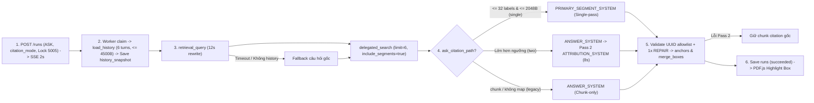

| Bước | Layer / Service | File & Symbol | Input / Auth / Guard | Persistence / External I/O | Output / Next State | Fallback / Error Guard |
| :--- | :--- | :--- | :--- | :--- | :--- | :--- |
| 1 | Submit Run & SSE Stream | `agent-orchestrator/app/main.py:start_run`, `run_events` | `mode="ASK"`, `citation_mode` (`segment`/`chunk`), `Idempotency-Key` (Lock `5005`) | Tạo `conversation_id` nếu chưa có; `INSERT orchestration.runs (status='queued')` | `202 Accepted`; Web mở `EventSource('/runs/{id}/events')` poll DB 2s/lần | Replay khác payload -> `409 idempotency_conflict` |
| 2 | Lease & Immutable History Snapshot | `worker.py:claim`, `load_history`, `history.py:prior_history` | `lease_id` (TTL `run + 15s`) | Lấy tối đa **6 lượt ASK thành công** trước `created_at` (mỗi answer `<= 900` chars, tổng snapshot `<= min(4500, input_limit//3)` bytes); lưu cứng vào `history_snapshot` JSONB | Ngữ cảnh lịch sử bất biến | Reclaim/Retry dùng lại `history_snapshot` đã lưu, không query lại DB |
| 3 | Standalone Query Rewrite | `worker.py:retrieval_query` | `REWRITE_SYSTEM`, `history` | Timeout **12s** gọi `model-gateway` (`SearchRewrite` JSON `{query}`) | Query độc lập gửi cho `retrieval-service` (`include_segments=True` nếu path != `legacy`) | Hết giờ / lỗi JSON / không có lịch sử -> fallback về **câu hỏi gốc** |
| 4 | Adaptive Citation Path Selection | `worker.py:ask_citation_path`, `compose` | `citation_mode` hoặc `ASK_SENTENCE_CITATIONS` | Đóng gói tối đa 6 passages (`id, text, section`) + history mới nhất vừa `max_input_bytes`. Nếu có `citation_segments_v1` và `<= 32` labels + overhead `<= 2048` bytes -> chọn `single` (`PRIMARY_SEGMENT_SYSTEM`), ngược lại chọn `two` | Chuẩn bị prompt tối ưu chi phí | Chunk không có segment map tự động dùng dạng legacy chunk |
| 5 | Answer Compose & Validation | `worker.py:compose`, `citations.py:resolve` | `GeneratedAskAnswer`, 1 lần `REPAIR` tự động nếu lỗi schema/UUID | Gọi `model-gateway` (`retry_on_unavailable=True`); đối soát mọi UUID trong `evidence` thuộc `cited` allowlist; claim `source="conversation"` bắt buộc `evidence=[]` | Danh sách `claims` đã hydrate | Vượt 1 lần repair -> `StopRun("invalid_model_output")` |
| 6 | Two-Pass Attribution & Box Merge | `worker.py:attribute`, `citations.py:attributed`, `anchors`, `merge_boxes` | Chỉ chạy khi `path == "two"`, timeout `min(8s, rem - 5s)`, max 512 tokens | Gửi claims + chỉ các parent chunk đã trích cho `ATTRIBUTION_SYSTEM`; `anchors()` gộp các câu liên tiếp cùng trang/precision, `merge_boxes()` hợp nhất box cùng dòng | `citation_id`, `segment_ids`, `regions`, `precision`; lưu `orchestration.runs` (`succeeded`) -> PDF.js `scrollIntoView` + tô sáng | Mọi lỗi/timeout ở Pass 2 **giữ nguyên chunk citation gốc**, không làm hỏng câu trả lời |

---

### Flow 10 — Fault Classification & Context-Isolated Manual Retry

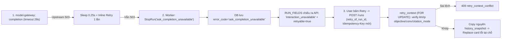

| Bước | Layer / Service | File & Symbol | Input / Auth / Guard | Persistence / External I/O | Output / Next State | Fallback / Error Guard |
| :--- | :--- | :--- | :--- | :--- | :--- | :--- |
| 1 | Gateway 503 Inline Retry | `model-gateway/app/main.py:completion` | `retry_on_unavailable=True` (tổng timeout 28s) | Gặp `503` từ upstream -> ngủ `0.25s` và gọi lại 1 lần trong cùng `X-Request-ID`; kiểm tra `content` rỗng do hết token reasoning | Trả `CompletionOutput` hoặc ném `503 chat_provider_unavailable` | Không bao giờ log nội dung prompt/reasoning/credentials |
| 2 | Worker Classification & Masking | `worker.py:complete`, `main.py:RUN_FIELDS` | Response `503` hoặc hết 1 lần repair | Lưu `error_code='ask_completion_unavailable'` hoặc `'invalid_model_output'`; API projection biến đổi thành `error_code='interaction_unavailable'` và `retryable=true` | UI hiển thị thông báo lỗi thân thiện (EN/VI) + nút **Retry** | Lỗi `cost_limit`/`time_limit`/khác có `retryable=false` |
| 3 | Context-Isolated Manual Retry | `agent-orchestrator/app/main.py:retry_context`, `interaction-panel.tsx:retry` | `retry_of_run_id`, `Idempotency-Key` mới | Khóa `FOR UPDATE` run cha; verify `objective`, `conversation_id`, `citation_mode` khớp 100%; **copy nguyên `history_snapshot`** sang run mới | Run mới thay thế tại chỗ card lỗi trên UI (in-place replacement) | Sai lệch payload -> `409 retry_context_conflict` |

---

## 5. Nhóm 4: Agentic Workflows — `PLAN`, `LEARN`, `RESEARCH`, `WRITE` (Flow 11–16)

### Flow 11 — Plan Lifecycle, Optimistic Locking & Custom 1–6 Step Workflows

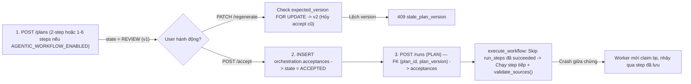

| Bước | Layer / Service | File & Symbol | Input / Auth / Guard | Persistence / External I/O | Output / Next State | Fallback / Error Guard |
| :--- | :--- | :--- | :--- | :--- | :--- | :--- |
| 1 | Create / Revise Plan | `agent-orchestrator/app/main.py:create_plan`, `revise`, `regenerate_plan` | `PlanDefinition` (nếu có `steps` 1–6 thì yêu cầu `AGENTIC_WORKFLOW_ENABLED=true`, step cuối bắt buộc `tool="compose"`) | `orchestration.plans` + `orchestration.plan_versions` (bất biến); sửa đổi dùng `FOR UPDATE` check `expected_version` | `state='REVIEW'`, tăng `current_version` | Lệch version -> `409 stale_plan_version`; sửa/sinh lại làm mất hiệu lực accept cũ |
| 2 | Approval Gating | `main.py:accept_plan`, `pinned_objective` | `Version(plan_version)`, `Idempotency-Key` | `INSERT INTO orchestration.acceptances (plan_id, version, user_id, request_key)` | `state='ACCEPTED'` | DB ràng buộc **Foreign Key `(plan_id, plan_version) -> acceptances`** không thể bypass |
| 3 | Step-by-Step Execution & Recovery | `worker.py:execute_workflow`, `save_step` | `mode="PLAN"`, `plan_id`, `plan_version` | Đọc các step đã `succeeded` từ `orchestration.run_steps`; trước mỗi step gọi `current()` + `validate_sources()`; định tuyến `compose` sang `CitedDraft`/`ResearchGraph` nếu bật cờ | Ghi `run_steps` sau mỗi bước (`retrieve` hoặc `compose`) | Crash giữa chừng ở step 2 -> worker mới claim lại sẽ **nhảy qua step 1 đã lưu** |

---

### Flow 12 — Async Curriculum Planner (`PLAN + LEARN + study_guide`)

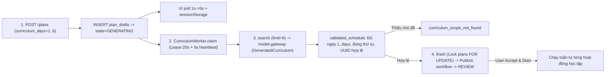

| Bước | Layer / Service | File & Symbol | Input / Auth / Guard | Persistence / External I/O | Output / Next State | Fallback / Error Guard |
| :--- | :--- | :--- | :--- | :--- | :--- | :--- |
| 1 | Enqueue Draft Job | `main.py:create_plan`, `add_revision` | `curriculum_days` (1–6), `steps=None`, bật cả `AGENTIC_CURRICULUM_ENABLED` & `AGENTIC_WORKFLOW_ENABLED` | `INSERT orchestration.plan_drafts (plan_id, version, days)` | `PlanView.state = 'GENERATING'`; UI poll exponential backoff 1s -> 5s và lưu `sessionStorage` để reload không mất | Bấm `accept` khi draft chưa xong -> `409` |
| 2 | Lease & Heartbeat | `curriculum.py:CurriculumWorker.claim`, `heartbeat` | `FOR UPDATE OF d SKIP LOCKED` | Lease 20s, task chạy nền gia hạn lease mỗi **5s** | `plan_drafts.status='running'` | Nếu bị `revise`/`cancel` trong lúc chạy -> bỏ qua publication (`draft_superseded`) |
| 3 | Read-Only Inspection & Schedule Validation | `curriculum.py:generate`, `validated_schedule` | `objective.query`, `days` | `POST retrieval-service /search` (`limit=6`); gọi `model-gateway` (`GeneratedCurriculum`: `study_guide\|explanation\|quiz\|flashcards\|mind_map`); check đủ từng ngày `1..days`, đúng thứ tự, UUID thuộc evidence | Chuyển `activities` thành `WorkflowStep[]` có `day` & `citations` | Không thấy chương/chủ đề -> `curriculum_scope_not_found`; lỗi tạm thời retry backoff `2^attempts` |
| 4 | Serialized Publication | `curriculum.py:finish` | `SELECT ... FROM orchestration.plans FOR UPDATE` (cùng lock với Edit/Accept/Cancel) | `UPDATE plan_versions SET workflow = ...` (chỉ khi chưa có acceptance); `plan_drafts.status='succeeded'` | `PlanView.state='REVIEW'`, sẵn sàng cho user duyệt & chạy | Bấm `Start` chạy từng bước học tập tuần tự ngay lập tức |

---

### Flow 13 — Socratic Tutor (`ASK + LEARN + socratic_tutor`)

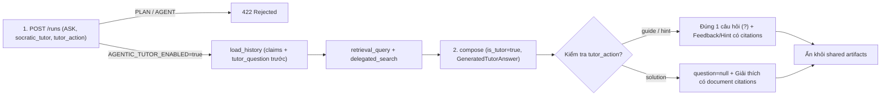

| Bước | Layer / Service | File & Symbol | Input / Auth / Guard | Persistence / External I/O | Output / Next State | Fallback / Error Guard |
| :--- | :--- | :--- | :--- | :--- | :--- | :--- |
| 1 | Route & Feature Gate | `main.py:start_run`, `types.py:StartRun` | `mode="ASK"`, `task="socratic_tutor"`, `tutor_action` (`guide`/`hint`/`solution`), `AGENTIC_TUTOR_ENABLED=true` | `prior_history` lấy cả `claims[*].text` và `tutor_question` các lượt trước | `ASK` conversation | Gửi ở `PLAN` hoặc `AGENT` -> **`422` rejected** |
| 2 | Pedagogical Compose & Guards | `worker.py:compose` (`is_tutor=True`) | `GeneratedTutorAnswer` (`claims` + `question`) | Kiểm tra rule: `guide`/`hint` bắt buộc có đúng **1 câu hỏi gợi mở** (`question.count("?") <= 1`); `solution` bắt buộc `question=null` và có ít nhất 1 `document` claim có trích dẫn | Trả lời phản hồi phân tích lỗi sai + câu hỏi gợi mở kèm citation pill | Không bao giờ trích dẫn nhận định sai của học viên làm bằng chứng sách; bị loại bỏ khi export shared artifact |

---

### Flow 14 — LangGraph Research Matrix (`ResearchGraph` — 2–5 Papers)

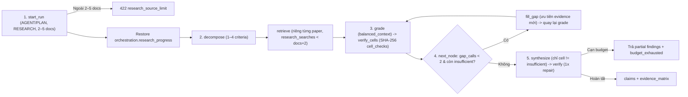

| Bước | Layer / Service | File & Symbol | Input / Auth / Guard | Persistence / External I/O | Output / Next State | Fallback / Error Guard |
| :--- | :--- | :--- | :--- | :--- | :--- | :--- |
| 1 | Guard & Checkpoint Restore | `main.py:start_run`, `research.py:ResearchGraph.execute` | `AGENT`/`PLAN` + `RESEARCH` + `comparison\|evidence_table\|synthesis` + `AGENTIC_RESEARCH_ENABLED=true` + **2–5 distinct docs** | Đọc checkpoint từ `orchestration.research_progress (run_id, scope)`; wrapper `record()` gọi `current()` + `validate_sources()` + `save()` sau mọi node | Khởi chạy LangGraph `StateGraph` (`recursion_limit=18`) | Ngoài 2–5 docs -> `422 research_source_limit`; crash khôi phục tại node dở dang |
| 2 | `decompose` -> `retrieve` | `research.py:decompose`, `retrieve`, `worker.py:retrieve` | `Decomposition` (1–4 criteria) | Lần lượt gọi `retrieval-service` **riêng cho từng paper** (`research_searches < docs + 2`); checkpoint sau mỗi paper đọc xong | `evidence[doc_id]` cân bằng theo từng bài báo | Vượt số lần search -> `StopRun("generation_budget")` |
| 3 | `grade` -> `verify_cells` | `research.py:grade`, `verify_cells`, `balanced_context` | `balanced_context` chia đều byte quota cho mỗi paper | Chấm từng ô `paper × criterion` (`Grading`); sau đó node `verify_cells` kiểm tra ngữ nghĩa lại bằng `CellVerification` (cache theo `sha256(cell)` trong `cell_checks`) | Ma trận `cells` (`supported` \| `contradicted` \| `insufficient`) | Phát hiện số liệu/đơn vị sai dù đúng UUID -> hạ ô xuống `insufficient` |
| 4 | Conditional `fill_gap` Loop | `research.py:next_node`, `fill_gap` | `gap_calls < 2` và còn ô `insufficient` chưa thử trong `gap_targets` | Gọi `retrieve(..., research_gap=True)` (`research_gap_searches < 2`); **đẩy kết quả mới lên đầu** `evidence[doc]` để ưu tiên trong quota; đặt `grading_document` để chỉ chấm lại đúng paper đó | Quay lại `grade` -> `verify_cells` | Hết 2 lần gap search hoặc hết ô thiếu -> sang `synthesize` |
| 5 | `synthesize` -> `verify` | `research.py:synthesize`, `verify` | Chỉ các cell `!= insufficient` | Tổng hợp `CandidateAnswer`, loại bỏ đề xuất không có evidence; `verify` kiểm tra ngữ nghĩa lần cuối (`Verification`), hỗ trợ **tối đa 1 lần repair** (bảo lưu các claim đã pass) | `claims` + `evidence_matrix` (`budget_exhausted` nếu cạn ngân sách) | Nếu chạm `cost_limit`/`generation_budget`/`time_limit` -> trả về **partial findings đã kiểm chứng** |

---

### Flow 15 — Verified Academic Writing (`CitedDraft` LangGraph)

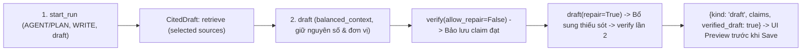

| Bước | Layer / Service | File & Symbol | Input / Auth / Guard | Persistence / External I/O | Output / Next State | Fallback / Error Guard |
| :--- | :--- | :--- | :--- | :--- | :--- | :--- |
| 1 | Graph Init & `retrieve` | `writing.py:CitedDraft` (kế thừa `ResearchGraph`) | `AGENT`/`PLAN` + `WRITE` + `draft` + `AGENTIC_WRITING_ENABLED=true` | Gom evidence cho tất cả `document_ids` trong scope (hoặc nhận `initial_evidence` từ `WorkflowStep` trước) | `state.evidence` theo từng tài liệu | Kiểm soát bởi `RESEARCH_MAX_TOTAL_OUTPUT_TOKENS` (16384) & `RESEARCH_MAX_MODEL_CALLS` (12) |
| 2 | `draft` -> `verify` + Repair | `writing.py:draft`, `verify` | `balanced_context` | Sinh các đoạn văn học thuật (`CandidateAnswer` giữ nguyên số liệu/đơn vị); chạy `super().verify(allow_repair=False)` giữ các claim đúng, rồi chạy `draft(repair=True)` bổ sung phần thiếu và `verify` lại | `{kind: 'draft', claims, verified_draft: true}` (Preview trước khi user bấm Save Artifact) | Mọi claim không chứng minh được đều bị tước bỏ |

---

### Flow 16 — Private Mock Defense (`ASK + RESEARCH + mock_defense`)

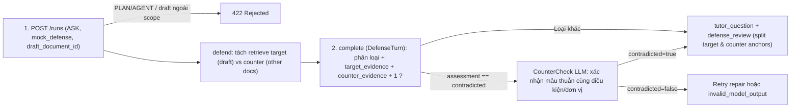

| Bước | Layer / Service | File & Symbol | Input / Auth / Guard | Persistence / External I/O | Output / Next State | Fallback / Error Guard |
| :--- | :--- | :--- | :--- | :--- | :--- | :--- |
| 1 | Draft & Counter Retrieval | `defense.py:defend`, `types.py:Objective` | `mode="ASK"`, `task="mock_defense"`, `draft_document_id` thuộc `document_ids`, `AGENTIC_DEFENSE_ENABLED=true` | Tách 2 luồng search: `target` (chỉ trong `draft_document_id`) và `counter` (các nguồn còn lại) | `balanced_context` phân biệt `targets` và `supplied` | Gửi ở `PLAN`/`AGENT` hoặc `draft_document_id` ngoài scope -> `422` |
| 2 | Defense Generation & Contradiction Check | `defense.py:defend` (`DefenseTurn`, `CounterCheck`) | `history` cuộc hội thoại riêng tư | Sinh 1 câu hỏi bảo vệ, phân loại: `missing_citation` \| `contradicted` \| `unsupported_assumption` \| `clarification`. Nếu là `contradicted` -> gọi thêm model `CounterCheck` xác nhận mâu thuẫn dưới cùng điều kiện/đơn vị | `tutor_question` + `defense_review` tách riêng `target_citations` (mở draft) và `counter_citations` (mở tài liệu phản biện) | Câu trả lời của sinh viên giữ riêng tư, bị tước khỏi export artifact |

---

## 6. Nhóm 5: Artifacts, Adaptive Learning & Source Discovery (Flow 17–21)

### Flow 17 — Artifact Publishing & MD/DOCX Export

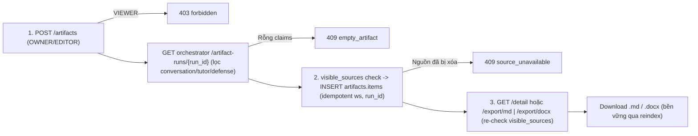

| Bước | Layer / Service | File & Symbol | Input / Auth / Guard | Persistence / External I/O | Output / Next State | Fallback / Error Guard |
| :--- | :--- | :--- | :--- | :--- | :--- | :--- |
| 1 | Sanitize Source Run | `artifact-service/app/main.py:publish`, `agent-orchestrator/app/main.py:artifact_run` | Role `OWNER` hoặc `EDITOR` (`VIEWER` -> `403`) | Gọi `GET /internal/v1/.../artifact-runs/{run_id}`; **loại bỏ hoàn toàn** `source="conversation"`, `tutor_question`, `defense_review` | Snapshot `body` chỉ chứa claim có trích dẫn tài liệu | Không còn claim nào -> `409 empty_artifact` |
| 2 | Visibility Check & Persist | `artifact-service/app/main.py:visible_sources`, `publish` | `source_ids` | Kiểm tra tất cả tài liệu nguồn vẫn tồn tại qua `document-service`; `INSERT INTO artifacts.items ... ON CONFLICT (workspace_id, run_id) DO NOTHING` | `201 Created` (bền vững dù sau này reindex hay đổi `citation_mode`) | Có nguồn đã bị xóa/thu hồi -> `409 source_unavailable` |
| 3 | Read & Export | `artifact-service/app/main.py:detail`, `export`, `make_docx` | Tất cả member (`VIEWER` được đọc/export) | Check lại `visible_sources`; export Markdown hoặc dựng `python-docx` trên threadpool | Download `artifact-{id}.md` hoặc `.docx` | Nguồn bị xóa sau khi tạo -> `409` (không lộ dữ liệu nguồn đã xóa) |

---

### Flow 18 — Adaptive Flashcards với FSRS (`StudyDeck`)

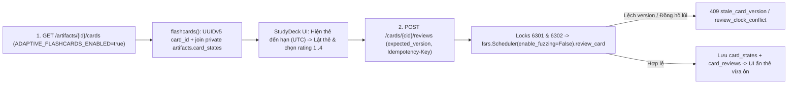

| Bước | Layer / Service | File & Symbol | Input / Auth / Guard | Persistence / External I/O | Output / Next State | Fallback / Error Guard |
| :--- | :--- | :--- | :--- | :--- | :--- | :--- |
| 1 | Card Projection & Deck | `artifact-service/app/learning.py:flashcards`, `reviews.py:deck` | `ADAPTIVE_FLASHCARDS_ENABLED=true`, `kind='flashcards'` | Tạo `card_id = uuid5(artifact_id, 'flashcard:v1:' + json([idx, front, back]))`; join `artifacts.card_states` riêng theo `(artifact_id, user_id)` | Trả thẻ kèm `version`, `due_at` (UTC), `is_due`, `citations` | `VIEWER` vẫn có lịch ôn tập riêng tư mà không sửa đổi artifact chung |
| 2 | Private FSRS Review | `reviews.py:review`, `study-deck.tsx:StudyDeck` | `rating` (`1=Again..4=Easy`), `expected_version`, `Idempotency-Key` | Advisory lock `6301` (idempotency `artifacts.card_reviews`) + `6302` (`card_states FOR UPDATE`); chạy `fsrs.Scheduler(enable_fuzzing=False).review_card` theo UTC | Cập nhật `version+1`, `schedule`, `due`; UI tự ẩn thẻ vừa ôn | Lệch `expected_version` -> `409 stale_card_version`; đồng hồ lùi -> `409 review_clock_conflict` |

---

### Flow 19 — Interactive Concept Map (`ConceptMap`)

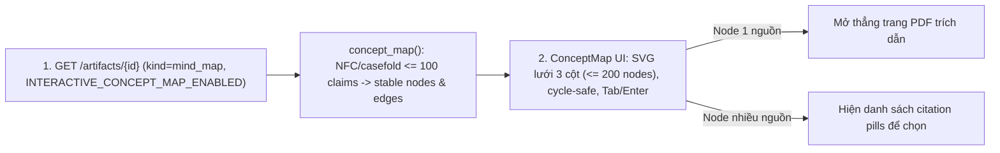

| Bước | Layer / Service | File & Symbol | Input / Auth / Guard | Persistence / External I/O | Output / Next State | Fallback / Error Guard |
| :--- | :--- | :--- | :--- | :--- | :--- | :--- |
| 1 | Graph Normalization | `artifact-service/app/learning.py:concept_map`, `main.py:detail` | `kind='mind_map'`, `INTERACTIVE_CONCEPT_MAP_ENABLED=true` | Chuẩn hóa Unicode NFC/casefold tối đa 100 claims thành `nodes` (`stable_id`) & `edges` (`source -> target`), gộp đa trích dẫn vào mỗi node | Trả `{nodes, edges}` kèm artifact detail | Tắt flag -> `concept_map: null` |
| 2 | Cycle-Safe SVG & Nav | `apps/web/app/workspaces/[workspaceId]/concept-map.tsx:ConceptMap` | React + SVG thuần (không thực thi HTML/SVG từ model) | Vẽ tối đa 200 nodes theo lưới 3 cột, tự xử lý self-loop/chu trình; hỗ trợ `Tab` + `Enter`/`Space` | Click node có 1 nguồn mở thẳng trang PDF; nhiều nguồn hiện danh sách citation pills | Lỗi nguồn bị xóa -> backend trả `409` |

---

### Flow 20 — Crossref Source Discovery & Reference Library

```mermaid
flowchart LR
    S1["1. SourceDiscovery UI: User sửa query & bấm Approve Crossref search"] --> S2["POST /references/discover -> GET api.crossref.org/works (10s)"]
    S2 -->|"Crossref timeout/429"| E1["503 discovery_unavailable"]
    S2 --> N["normalize(): Trả Reference metadata (chưa phải RAG evidence)"]
    N -->|"OWNER/EDITOR bấm Save"| S3["2. POST /references (upsert theo ws, doi) | GET /export (.bib) | POST /remove"]
    S3 -->|"VIEWER lưu/xóa"| E2["403 forbidden"]
```

| Bước | Layer / Service | File & Symbol | Input / Auth / Guard | Persistence / External I/O | Output / Next State | Fallback / Error Guard |
| :--- | :--- | :--- | :--- | :--- | :--- | :--- |
| 1 | Approval-Gated Discovery | `source-discovery.tsx:SourceDiscovery`, `workspace-service/app/main.py:discover` | Bấm **"Approve Crossref search"** (`query` 1–200 chars, user tự sửa trước khi duyệt) | `GET https://api.crossref.org/works` (timeout 10s), normalize DOI/title/authors/year qua `research.py:normalize` | Danh sách `Reference` (chỉ metadata, **tuyệt đối không tự vào RAG evidence**) | Crossref timeout/429 -> `503 discovery_unavailable` |
| 2 | Save, Remove & BibTeX Export | `workspace-service/app/main.py:save_reference`, `export_references`, `remove_reference` | `OWNER`/`EDITOR` (lưu/xóa); mọi member (đọc/export) | Upsert `workspace.reference_items` theo `(workspace_id, doi)` kèm `tags`; xuất chuỗi `.bib` qua `research.py:bibtex` | Lưu thư viện tham khảo hoặc tải `references.bib` | `VIEWER` lưu/xóa -> `403 forbidden` |

---

### Flow 21 — Document Reader & Personal Annotations

```mermaid
flowchart LR
    S1["1. PdfPreview: HEAD probe + Range stream GET /preview (hoặc /original)"] -->|"DOCX chưa xong preview"| E1["409 preview_unavailable"]
    S1 --> R["pdfjs-dist Canvas render + Overlay citationBoxes (scrollIntoView) + Local text search"]
    R --> S2["2. AnnotatedPreview: GET/POST/DELETE /annotations (lọc theo ws, doc, user)"]
    S2 --> OK["Ghi chú/highlight riêng tư per-user, tự dọn khi xóa doc/workspace"]
```

| Bước | Layer / Service | File & Symbol | Input / Auth / Guard | Persistence / External I/O | Output / Next State | Fallback / Error Guard |
| :--- | :--- | :--- | :--- | :--- | :--- | :--- |
| 1 | Protected PDF Streaming | `document-service/app/main.py:preview`, `original`, `pdf-preview.tsx:PdfPreview` | Member workspace; `HEAD` probe + Range requests | Đọc từ MinIO (`original` hoặc `preview.pdf` của DOCX) -> render bằng `pdfjs-dist` trên Canvas; overlay `citationBoxes` (`citationRegions` hoặc `citationRegion`) | Hiển thị trang PDF, search text nội bộ, tự cuộn tới highlight box | DOCX chưa convert xong -> `409 preview_unavailable` |
| 2 | Private Annotations & Highlights | `document-service/app/main.py:list_annotations`, `annotate`, `annotated-preview.tsx` | `page >= 1`, `body` và/hoặc normalized `region` `[0,1]` | Query/Insert/Delete trên `documents.annotations` lọc chặt theo `(workspace_id, document_id, user_id)` | Ghi chú/highlight **riêng tư từng user**, giữ nguyên sau reload | Xóa document hoặc xóa workspace tự động xóa toàn bộ `annotations` |

---

## 7. Tổng hợp Advisory Locks, Leases & Runtime Budgets

| Cơ chế / Hằng số | Giá trị / Lock ID | Service áp dụng | Mục đích |
| :--- | :--- | :--- | :--- |
| **PG Advisory Lock `710109`** | Transaction lock | `auth-service` | Tuần tự hóa thao tác admin thay đổi role/disable tài khoản |
| **PG Advisory Lock `2002`** | `hashtextextended(ws, 2002)` | `document-service` | Đồng bộ upload reservation, xóa tài liệu và dọn dẹp workspace |
| **PG Advisory Lock `2003`** | `hashtextextended(ws, 2003)` | `ingestion-service` | Đồng bộ RabbitMQ lifecycle event, batch publication và `reindex.py` |
| **PG Advisory Lock `5005`** | `hashtextextended(ws:user:key, 5005)` | `agent-orchestrator` | Bảo vệ idempotency khi `POST /runs` |
| **PG Advisory Locks `6301`/`6302`** | `hashtextextended(user:key / user:art:card)` | `artifact-service` | Bảo vệ idempotency review FSRS và lock `card_states` |
| **`RuntimeBudgets` (`rag_runtime.py`)** | `parse=300s`, `embedding=60s`, `index=1800s`, `run=210s`, `batch=16` | Toàn hệ thống | Ràng buộc startup: `index > parse_caller + embedding_caller + 30` và `run > search_caller + 75` |
| **Worker Run & Research Caps** | `RUN_MAX_ATTEMPTS=2` (max 3), `RUN_MAX_OUTPUT_TOKENS=800` (max 2048), `RUN_MAX_INPUT_BYTES=14000`, `RESEARCH_MAX_MODEL_CALLS=12`, `RESEARCH_MAX_TOTAL_OUTPUT_TOKENS=16384`, `research_gap_searches < 2` | `agent-orchestrator` | Giới hạn chặt chẽ số lần gọi model, output tokens, chi phí micro-USD và số lượt tìm kiếm mở rộng |
